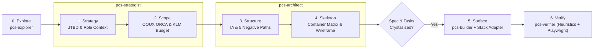

# Product Composition System (`pcs`)

**`pcs` is a 100% standalone, self-contained Product, UX/UI & Frontend Engineering Orchestrator and Go CLI that transforms AI coding agents from impulsive component generators into disciplined Product Engineers.** Built with direct native integration for `Engram` (persistent memory), `CodeGraph` (structural AST intelligence), and `Context7` (live library documentation), `pcs` enforces **Product-Centered Development (PCD)** across the 5 Planes of UX before a single line of `.tsx` is written.

---

## Installation

`pcs` is a single static binary with no runtime dependencies. Pick one method; every method installs the same `pcs` command. Check the result with `pcs version`, which prints the version, commit, and build date.

### Option 1 — `go install` (any OS, Go 1.24+)

```bash
go install github.com/yorth21/pcs/cmd/pcs@latest   # or @v1.2.3 for a specific release
```

`go install` writes the binary to `$(go env GOPATH)/bin`: `~/go/bin` on macOS/Linux, `%USERPROFILE%\go\bin` on Windows. That directory must be on your `PATH`:

```bash
# macOS / Linux (add to ~/.zshrc or ~/.bashrc)
export PATH="$PATH:$(go env GOPATH)/bin"
```

```powershell
# Windows (PowerShell): append to the user PATH, then open a new terminal
$p = [Environment]::GetEnvironmentVariable('Path', 'User'); [Environment]::SetEnvironmentVariable('Path', "$p;$env:USERPROFILE\go\bin", 'User')
```

### Option 2 — Download a release binary

Each [GitHub release](https://github.com/yorth21/pcs/releases) publishes `pcs_<version>_<os>_<arch>` archives for `windows_amd64` (`.zip`), `darwin_arm64` and `darwin_amd64` (`.tar.gz`), and `linux_amd64` (`.tar.gz`), plus a `checksums.txt` (SHA-256). Always verify the archive against `checksums.txt` before installing it. Set `VERSION` to the release without its leading `v`.

```bash
# Linux (amd64)
VERSION=1.2.3
ARCHIVE="pcs_${VERSION}_linux_amd64.tar.gz"
curl -fsSLO "https://github.com/yorth21/pcs/releases/download/v${VERSION}/${ARCHIVE}"
curl -fsSLO "https://github.com/yorth21/pcs/releases/download/v${VERSION}/checksums.txt"
grep " ${ARCHIVE}\$" checksums.txt | sha256sum --check -
tar -xzf "$ARCHIVE" pcs && mkdir -p ~/.local/bin && install -m 0755 pcs ~/.local/bin/pcs
```

```bash
# macOS (darwin_arm64 for Apple silicon, darwin_amd64 for Intel)
VERSION=1.2.3
ARCHIVE="pcs_${VERSION}_darwin_arm64.tar.gz"
curl -fsSLO "https://github.com/yorth21/pcs/releases/download/v${VERSION}/${ARCHIVE}"
curl -fsSLO "https://github.com/yorth21/pcs/releases/download/v${VERSION}/checksums.txt"
grep " ${ARCHIVE}\$" checksums.txt | shasum -a 256 --check -
tar -xzf "$ARCHIVE" pcs && mkdir -p ~/.local/bin && install -m 0755 pcs ~/.local/bin/pcs
```

The binaries are not code-signed. A download made with `curl` is not quarantined; if you downloaded the archive with a browser instead, run `xattr -d com.apple.quarantine ~/.local/bin/pcs` once.

```powershell
# Windows (PowerShell, amd64)
$Version = '1.2.3'
$Archive = "pcs_${Version}_windows_amd64.zip"
Invoke-WebRequest "https://github.com/yorth21/pcs/releases/download/v$Version/$Archive" -OutFile $Archive
Invoke-WebRequest "https://github.com/yorth21/pcs/releases/download/v$Version/checksums.txt" -OutFile checksums.txt
$expected = ((Get-Content checksums.txt) | Where-Object { $_ -match " $([regex]::Escape($Archive))$" }).Split(' ')[0]
$actual = (Get-FileHash $Archive -Algorithm SHA256).Hash.ToLower()
if ($actual -ne $expected) { throw "checksum mismatch for $Archive" }
Expand-Archive $Archive -DestinationPath "$env:LOCALAPPDATA\pcs\bin" -Force
```

Put the install directory (`~/.local/bin`, or `%LOCALAPPDATA%\pcs\bin` on Windows) on your `PATH` as shown in Option 1. No package-manager distribution (Homebrew, Scoop, winget) exists yet.

### Option 3 — Build from source

```bash
git clone https://github.com/yorth21/pcs.git && cd pcs
make build          # writes bin/pcs with version, commit, and build date
make install        # or: go install into $(go env GOPATH)/bin
```

Without `make`, `go build -o bin/pcs ./cmd/pcs` works on every OS; `pcs version` then reports the Go build metadata (or `dev`) instead of the release version.

---

## Quick Path — Install & Launch (`pcs` CLI)

Build the zero-dependency Go binary and install `pcs` (`--scope global` by default, respecting `$CLAUDE_CONFIG_DIR` and `$PCS_INSTALL_SCOPE`, `--scope workspace` for repository-level installation, or `--scope profile` for a dedicated `~/.claude-pcs` profile with POSIX/Windows launchers; profile scope ignores `$CLAUDE_CONFIG_DIR`, is selected only by `--profile-dir`, and refuses any target that is the home directory, the main config directory or one of its ancestors, or whose `.claude.json`/`settings.json` is the main profile's file). Without `--scope` (or `--profile-dir`/`--target-dir`/`PCS_INSTALL_SCOPE`), `pcs install` refuses when only a profile install exists, so the global default never adds a second install by accident:

```bash
# 1. Build the standalone Go CLI
make build

# 2. Safe default install into the global Claude config (~/.claude, or $CLAUDE_CONFIG_DIR if set)
#    Writes CLAUDE.md markers, 5 native subagents, and skills without touching .claude.json or settings.json:
./bin/pcs install --adapter react-shadcn --persona gentleman

# Optional: also merge missing MCP servers (engram, context7, codegraph) and/or the skill-registry hook:
./bin/pcs install --write-mcp-config --write-hook

# Or install into a specific frontend repository (--scope workspace)
./bin/pcs install --scope workspace --target-dir /path/to/frontend-repo/.claude

# Or install into an isolated profile (--scope profile) with sh / .cmd / .ps1 launchers
./bin/pcs install --scope profile --profile-dir ~/.claude-pcs

# 3. Verify binaries, embedded brain, markers, native subagents, and skills
./bin/pcs doctor
```

### CLI Command Reference

| Command | Purpose |
|---------|---------|
| `pcs install [--scope global\|workspace\|profile] [--profile-dir <dir>] [--target-dir <dir>] [--launcher-dir <dir>] [--launcher-args <args>] [--with-plugins] [--no-statusline] [--adapter react-shadcn] [--persona gentleman\|neutral] [--mcp-guidance=true\|false] [--write-mcp-config] [--write-hook] [--dry-run] [--json]` | Deploy `pcs` orchestrator & infrastructure markers (`pcs:*`), 5 native subagents, and `pcs-core` + Stack Adapter skills. In profile scope, installs `claude-pcs` launchers on PATH, isolates environment, generates `shared-mcp.json`, and inherits status line |
| `pcs sync [--scope global\|workspace\|profile] [--profile-dir <dir>] [--target-dir <dir>] [--launcher-dir <dir>] [--launcher-args <args>] [--with-plugins] [--no-statusline] [--adapter <name>] [--persona <name>] [--mcp-guidance=true\|false] [--write-mcp-config] [--write-hook] [--dry-run] [--json]` | Re-synchronize embedded `brain/` files and `pcs:*` markers using `.pcs-state.json` (including the persisted `--no-statusline` and `--with-plugins` choices) while honoring any explicit flag overrides such as `--no-statusline=false`. A state written by an older `pcs` (no `schema_version`) is migrated: an unknown `--no-statusline` choice keeps the profile's current statusLine state (nothing is copied into a profile without one), and missing `added_*` records become empty records only when none of the default entries is present. `sync` never creates an install: it exits non-zero when the target has no `.pcs-state.json`. Without `--scope`/`--profile-dir`/`--target-dir` (and no `PCS_INSTALL_SCOPE`), it discovers existing installs (global target and default `~/.claude-pcs` profile) and syncs the single one found; when several exist it lists them and requires `--scope` |
| `pcs status [--scope global\|workspace\|profile] [--profile-dir <dir>] [--target-dir <dir>] [--json]` | Inspect installed `CLAUDE.md` markers (`pcs:*`), native subagents, skills, and MCP configuration |
| `pcs doctor [--scope global\|workspace\|profile] [--profile <name>] [--profile-dir <dir>] [--target-dir <dir>] [--json]` | Run diagnostic checks on `engram`, `codegraph`, `npx`, `git`, embedded `BrainFS`, and target installation (including profile authentication and PATH status) |
| `pcs skill-registry refresh [--cwd <dir>] [--skills-dir <dir>] [--json]` | Scan `SKILL.md` frontmatter and write deterministic `.atl/pcs-skill-registry.md` with SHA-256 cache-hit header |
| `pcs codegraph init [--cwd <dir>] [--json]` | Validate project root (refusing `$HOME`, `/`, `os.TempDir()`, `/tmp`, `/var/tmp`) and initialize `.codegraph/` index |
| `pcs uninstall [--scope global\|workspace\|profile] [--profile-dir <dir>] [--target-dir <dir>] [--remove-mcp [--force]] [--dry-run] [--json]` | Cleanly remove all 5 `pcs:*` markers, `pcs-*` native subagents, `pcs-*` skills, `.atl/pcs-skill-registry.md`, launchers, `shared-mcp.json`, and `pcs`-added MCP/hook deltas without touching user files. MCP servers, permissions, and plugins are removed only when `.pcs-state.json` records that `pcs` added them (an empty record removes nothing). Without a record, `--remove-mcp` refuses unless `--force` is given, which removes the default `engram`, `context7`, and `codegraph` entries and the `engram@engram` plugin with a warning. The profile `statusLine` is removed only while it still equals the value `pcs` copied (an edited one is kept and reported). Files and settings containers (`permissions`, `permissions.allow`, `enabledPlugins`) that `pcs` created are deleted once nothing but `pcs` entries was in them, so no empty `settings.json` is left behind. Every `*.pre-pcs.bak` backup is kept and listed in the report; `pcs` never writes one for a file it created itself. Without `--scope`/`--profile-dir`/`--target-dir` (and no `PCS_INSTALL_SCOPE`), it discovers existing installs like `sync`: it removes the single one found, and refuses when none or several exist. `--force` requires `--scope`, `--profile-dir`, or `--target-dir` on the command line (`PCS_INSTALL_SCOPE` alone is not enough) |
| `pcs flow start --feature <kebab> --kind audit\|inline\|t2\|t3` / `status` / `next` / `record --phase <p> --status done\|blocked [--agent-id x]` / `close [--abandon --reason "..."]` (all accept `--cwd <dir>` and `--json`) | Deterministic PCD flow state in `<project>/.pcs/flows/<feature>.json` with one active flow per project (`.pcs/active`). Every command prints a typed `pcs.flow.transition/v1` `next_transition` (`start`, `delegate`, or `close`) whose command or instruction the model runs verbatim. `close` refuses while mandatory phases are pending unless `--abandon` carries a non-empty reason; `record` is a manual fallback marked `source: "manual"` |
| `pcs hook pre-tool-use\|subagent-stop\|stop\|user-prompt-submit` | Claude Code hook entry points (read the hook JSON from stdin, always exit 0, fail open). `pre-tool-use` gates main-thread source reads (`Read`/`Grep`/`Glob` and non-allowlisted `Bash`), edits, and out-of-order `pcs-*` delegations; `subagent-stop` records the phase from the subagent's Return Envelope `**Status**`; `stop` blocks ending a turn while the active flow is incomplete (or complete but not closed); `user-prompt-submit` injects the flow rule or the active flow's next step. Installed by default with `--scope profile` (`--no-hooks` opts out; other scopes need `--with-hooks`) |
| `pcs version [--json]` | Print the `pcs` version, commit, and build date (set at release build time, or read from the Go build info for `go install`) |

---

## Why `pcs` Exists

Standard AI coding workflows jump straight from a vague user prompt to Plane 5 (`Surface` code), producing fragmented domain objects, modal-inside-modal antipatterns, missing empty/error states, and redundant wrapper components. `pcs` fixes the root cause by making **Strategy, Scope, Structure, and Skeleton** mandatory engineering gates.

| Dimension | Code-First AI Workflow | Product Composition System (`pcs`) |
|-----------|------------------------|------------------------------------|
| **Starting Point** | Immediate `.tsx` generation | 5 Planes of UX (Strategy -> Scope -> Structure -> Skeleton -> Surface) |
| **Domain Coherence** | Scattered cards and ad-hoc props | OOUX ORCA Object Map (Objects, Relationships, CTAs, Attributes) |
| **Container Choice** | Arbitrary modals for everything | Context-Dependent Matrix (`Inline` vs `Dialog` vs `Sheet` vs `Full Page`) |
| **Negative States** | Happy path only | 5 Mandatory States (`Zero-Data`, `No-Results`, `Loading`, `Partial Error`, `Validation Error`) |
| **Component Hygiene** | Over-abstracted custom wrappers | Strict KISS + Vanilla `shadcn/ui` composition + Promotion Rule |
| **Verification** | "It compiles" | 10 Usability Heuristics (0–4 scale) + 4-Question Cognitive Walkthrough + Playwright |

---

## How Product-Centered Development (PCD) Works



---

## The 5 Planes of PCD

| Plane | Executor | Core Methodology | Concrete Engineering Output |
|-------|----------|------------------|-----------------------------|
| **0. Discovery** | `pcs-explorer` | CodeGraph AST + UX Inventory | Route map, reusable `src/components/*` inventory, domain object map |
| **1. Strategy** | `pcs-strategist` | Goal-Directed Design + JTBD | User role environment, frequency of use, JTBD statement, Declared Assumptions |
| **2. Scope** | `pcs-strategist` | OOUX (ORCA) + HTA/KLM + Story Mapping | Object-Relationship-CTA-Attribute matrix, pruned click/keystroke budget |
| **3. Structure** | `pcs-architect` | Information Architecture + State Flows | Navigation hierarchy (<= 2 levels) + Happy Path + 5 Mandatory Negative Paths |
| **4. Skeleton** | `pcs-architect` | Empirical Cognitive Laws + Wireframing | Context-Dependent Container Matrix, Risk-Proportional Friction, ASCII Wireframe, Tasks |
| **5. Surface** | `pcs-builder` | Agnostic Surface + Stack Adapter | 60-30-10 color budget, 3-level typography, `tabular-nums`, vanilla `shadcn/ui` code |
| **Verification** | `pcs-verifier` | 10 Heuristics + Cognitive Walkthrough | 0–4 severity audit (0 Severity 3–4 blockers allowed), WCAG AA, Playwright check |

---

## Repository Architecture

```text
pcs/
├── README.md                          # Executive overview and CLI quick path
├── AGENTS.md                          # Project skill, subagent, and CLI package registry
├── Makefile                           # Build, test, test-race, and vet targets
├── go.mod                             # Zero-external-dependency Go module
├── embed.go                           # //go:embed all:brain docs/skill-style-guide.md
├── cmd/pcs/main.go                    # Standalone pcs CLI entrypoint
├── internal/
│   ├── assets/                        # Embedded BrainFS accessors and pcs:* infrastructure blocks
│   ├── marker/                        # Idempotent HTML-comment marker engine for CLAUDE.md
│   ├── mcp/                           # Engram, Context7 & CodeGraph JSON merger/unmerger with delta tracking
│   ├── installer/                     # Multi-scope (global, workspace, profile) lifecycle engine
│   ├── registry/                      # Deterministic .atl/pcs-skill-registry.md generator
│   ├── doctor/                        # Ecosystem binary, BrainFS, and installation verifier
│   └── cli/                           # Subcommand router, codegraph init guard, and flag parser
├── docs/
│   ├── architecture.md                # Standalone system architecture, MCP integration & CLI design
│   └── skill-style-guide.md           # Normative LLM-first skill style guide
└── brain/
    ├── orchestrator/
    │   ├── pcs-orchestrator.md        # <!-- pcs:orchestrator --> Coordinator & delegation rules
    │   └── pcs-routing.md             # <!-- pcs:ux-routing --> Mandatory 8-step PCD workflow
    ├── agents/
    │   ├── pcs-explorer.md            # Read-only UX & frontend architecture mapper
    │   ├── pcs-strategist.md          # Planes 1 & 2 executor (Strategy & Scope)
    │   ├── pcs-architect.md           # Planes 3 & 4 executor (Structure, Skeleton & Tasks)
    │   ├── pcs-builder.md             # Plane 5 executor (Surface & Stack Adapter composition)
    │   └── pcs-verifier.md            # Heuristic, accessibility & Playwright verifier
    └── skills/
        ├── _shared/
        │   └── pcs-phase-common.md    # Shared artifact locators, Engram persistence & Result Envelope
        ├── pcs-core/                  # Technology-agnostic UX & Product Engineering methodology
        │   ├── SKILL.md
        │   ├── references/            # Deep rules for Planes 1-5, Cognitive Laws & Heuristics
        │   └── assets/                # Markdown templates for pcs/specs/ and pcs/tasks/
        └── pcs-adapter-react-shadcn/  # React 19 + shadcn/ui + TanStack + RHF/Zod + Tailwind v4
            ├── SKILL.md
            ├── references/            # Folder rules, vanilla catalog, TanStack/RHF & Tailwind v4
            └── assets/                # Production-grade TypeScript composition blueprints
```

---

## Using `pcs` as a Separate Profile Next to `gentle-ai`

If you already have another orchestrator or tool installed in your global `~/.claude` (such as `gentle-ai`), you can run `pcs` in complete isolation using **Profile Scope**:

```bash
# 1. Install pcs into a dedicated profile
pcs install --scope profile --profile-dir ~/.claude-pcs --adapter react-shadcn --persona gentleman

# 2. Check diagnostic health and profile status
pcs doctor --scope profile
```

### Why Profile Scope is Safe & Seamless

1. **Zero Global Mutation**: Does not touch `~/.claude/CLAUDE.md`, `~/.claude.json`, or existing global plugins.
2. **Process-Scoped Launcher on `PATH`**: Installs `claude-pcs` (POSIX), `claude-pcs.cmd` (Windows Command Prompt), and `claude-pcs.ps1` (PowerShell) directly into your user bin directory (`~/.local/bin` on Unix/macOS or `%LOCALAPPDATA%\pcs\bin` on Windows, customizable via `--launcher-dir`). The launcher executes `claude` with `CLAUDE_CONFIG_DIR` scoped strictly to that invocation, so your interactive shell environment is never contaminated.
3. **MCP Server Sharing (`shared-mcp.json`)**: Reads the MCP server definitions from your main profile's `~/.claude.json` and copies them to `<profile-dir>/shared-mcp.json` (chmod 0600). The launcher invokes Claude with `--mcp-config <profile-dir>/shared-mcp.json`, allowing full access to your existing MCP tools without duplicate configuration or risk of file corruption. Every pcs agent requires Engram, so when the main profile defines no `engram` MCP server (for example because it uses the `engram@engram` plugin), `shared-mcp.json` also gets an `engram` server pointing at the resolved `engram` binary (`engram mcp --tools=agent`); when no `engram` binary is found, no broken entry is written and the report warns with the install hint. `--mcp-config` is always the last launcher argument, so `claude-pcs "fix the bug" --resume <id>` passes your own arguments through unchanged. Default launcher arguments from `--launcher-args` are split on whitespace (single or double quotes group words, with no escape character) and passed literally, without shell expansion.
4. **Status Line & Plugin Parity**: Automatically inherits your custom `statusLine` command from `~/.claude/settings.json` (skip with `--no-statusline`). Pass `--with-plugins` to add the `engram` marketplace and install the `engram@engram` plugin into the profile (failures are reported with the exact manual command), or install it manually with `CLAUDE_CONFIG_DIR` scoped to those commands only (POSIX: `CLAUDE_CONFIG_DIR=~/.claude-pcs claude plugin marketplace add Gentleman-Programming/engram; CLAUDE_CONFIG_DIR=~/.claude-pcs claude plugin install engram@engram`; pcs prints the exact PowerShell and cmd.exe forms, which restore or discard the variable afterwards). Both choices are remembered by `pcs sync`. After install, pcs prints `claude-pcs` as the launch command (or the launcher's absolute path when its directory is not on `PATH`); no printed hint leaves `CLAUDE_CONFIG_DIR` set in your shell.
5. **First-Run Authentication**: Run `claude-pcs` and enter `/login` on first launch. `pcs doctor --scope profile` verifies launchers, `shared-mcp.json` drift against the main profile (the `engram` server pcs adds is not drift), that Engram is available (an `engram` server in `shared-mcp.json` or the `engram@engram` plugin enabled in the profile; fails otherwise), requested plugins in the profile `settings.json`, and `.credentials.json` (reported as unknown on macOS, where credentials live in the Keychain).
6. **Launcher `PATH` Hint**: When the launcher directory is not on `PATH`, `pcs` prints a per-OS command. On Windows it appends only to the user `PATH` from PowerShell (`[Environment]::SetEnvironmentVariable('Path', ..., 'User')`) instead of `setx`, which truncates at 1024 characters and copies the system `PATH`.

---

## Core vs. Stack Adapter Separation

- **[`pcs-core`](brain/skills/pcs-core/SKILL.md)**: 100% technology-agnostic product engineering rules. Contains zero framework couplings and zero external company references. Every rule is encoded as a self-contained engineering constraint.
- **[`pcs-adapter-react-shadcn`](brain/skills/pcs-adapter-react-shadcn/SKILL.md)**: Translates `pcs-core` Skeleton and Surface decisions into idiomatic React 19, TypeScript, Tailwind CSS v4, vanilla `shadcn/ui`, `radix-ui`, `@tanstack/react-router`, `@tanstack/react-query`, `@tanstack/react-table`, and `react-hook-form` + `zod`.

---

## Quick Verification Checklist

- [ ] Run `go test -v -race ./...` and `go vet ./...` to verify all CLI packages and embedded assets.
- [ ] Read [`docs/architecture.md`](docs/architecture.md) for the standalone architecture, `Engram` / `CodeGraph` / `Context7` integration, and CLI lifecycle internals.
- [ ] Read [`docs/skill-style-guide.md`](docs/skill-style-guide.md) before authoring or modifying any `SKILL.md`.
- [ ] Inspect [`AGENTS.md`](AGENTS.md) for the authoritative index of skills, orchestrator blocks, subagents, and Go packages.
