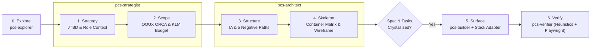

# Product Composition System (`pcs`)

**`pcs` is an LLM-first Product & UX/UI Brain that transforms AI coding agents from impulsive component generators into disciplined Product Engineers.** Built as a specialized layer on top of `gentle-ai`, `pcs` enforces **Product-Centered Development (PCD)** across the 5 Planes of UX before a single line of `.tsx` is written.

---

## Why `pcs` Exists

Standard AI coding workflows jump straight from a vague user prompt to Plane 5 (`Surface` code), producing fragmented domain objects, modal-inside-modal antipatterns, missing empty/error states, and redundant wrapper components. `pcs` fixes the root cause by making **Strategy, Scope, Structure, and Skeleton** mandatory engineering gates.

| Dimension | Code-First AI Workflow | Product Composition System (`pcs`) |
|-----------|------------------------|------------------------------------|
| **Starting Point** | Immediate `.tsx` generation | 5 Planes of UX (Strategy -> Scope -> Structure -> Skeleton -> Surface) |
| **Domain Coherence** | Scattered cards and ad-hoc props | OOUX ORCA Object Map (Objects, Relationships, CTAs, Attributes) |
| **Container Choice** | Arbitrary modals for everything | Context-Dependent Matrix (`Inline` vs `Dialog` vs `Sheet` vs `Full Page`) |
| **Negative States** | Happy path only | 5 Mandatory States (`Zero-Data`, `No-Results`, `Loading`, `Partial Error`, `Validation Error`) |
| **Component Hygiene** | Over-abstracted custom wrappers | Strict KISS + Vanilla `shadcn/ui` composition + Promotion Rule |
| **Verification** | "It compiles" | 10 Usability Heuristics (0–4 scale) + 4-Question Cognitive Walkthrough + Playwright |

---

## How Product-Centered Development (PCD) Works



---

## The 5 Planes of PCD

| Plane | Executor | Core Methodology | Concrete Engineering Output |
|-------|----------|------------------|-----------------------------|
| **0. Discovery** | `pcs-explorer` | CodeGraph AST + UX Inventory | Route map, reusable `src/components/*` inventory, domain object map |
| **1. Strategy** | `pcs-strategist` | Goal-Directed Design + JTBD | User role environment, frequency of use, JTBD statement, Declared Assumptions |
| **2. Scope** | `pcs-strategist` | OOUX (ORCA) + HTA/KLM + Story Mapping | Object-Relationship-CTA-Attribute matrix, pruned click/keystroke budget |
| **3. Structure** | `pcs-architect` | Information Architecture + State Flows | Navigation hierarchy (<= 2 levels) + Happy Path + 5 Mandatory Negative Paths |
| **4. Skeleton** | `pcs-architect` | Empirical Cognitive Laws + Wireframing | Context-Dependent Container Matrix, Risk-Proportional Friction, ASCII Wireframe, Tasks |
| **5. Surface** | `pcs-builder` | Agnostic Surface + Stack Adapter | 60-30-10 color budget, 3-level typography, `tabular-nums`, vanilla `shadcn/ui` code |
| **Verification** | `pcs-verifier` | 10 Heuristics + Cognitive Walkthrough | 0–4 severity audit (0 Severity 3–4 blockers allowed), WCAG AA, Playwright check |

---

## Repository Architecture

```text
pcs/
├── README.md                          # Executive overview and quick path
├── AGENTS.md                          # Project skill and native subagent registry
├── docs/
│   ├── architecture.md                # Two-layer architecture (gentle-ai + pcs) & deployment model
│   └── skill-style-guide.md           # Normative LLM-first skill style guide
└── brain/
    ├── orchestrator/
    │   ├── pcs-orchestrator.md        # <!-- pcs:orchestrator --> Coordinator & delegation rules
    │   └── pcs-routing.md             # <!-- pcs:ux-routing --> Mandatory 8-step PCD workflow
    ├── agents/
    │   ├── pcs-explorer.md            # Read-only UX & frontend architecture mapper
    │   ├── pcs-strategist.md          # Planes 1 & 2 executor (Strategy & Scope)
    │   ├── pcs-architect.md           # Planes 3 & 4 executor (Structure, Skeleton & Tasks)
    │   ├── pcs-builder.md             # Plane 5 executor (Surface & Stack Adapter composition)
    │   └── pcs-verifier.md            # Heuristic, accessibility & Playwright verifier
    └── skills/
        ├── _shared/
        │   └── pcs-phase-common.md    # Shared artifact locators, Engram persistence & Result Envelope
        ├── pcs-core/                  # Technology-agnostic UX & Product Engineering methodology
        │   ├── SKILL.md
        │   ├── references/            # Deep rules for Planes 1-5, Cognitive Laws & Heuristics
        │   └── assets/                # Markdown templates for pcs/specs/ and pcs/tasks/
        └── pcs-adapter-react-shadcn/  # React 19 + shadcn/ui + TanStack + RHF/Zod + Tailwind v4
            ├── SKILL.md
            ├── references/            # Folder rules, vanilla catalog, TanStack/RHF & Tailwind v4
            └── assets/                # Production-grade TypeScript composition blueprints
```

---

## Core vs. Stack Adapter Separation

- **[`pcs-core`](file:///Users/yorth21/Developer/SideProjects/pcs/brain/skills/pcs-core/SKILL.md)**: 100% technology-agnostic product engineering rules. Contains zero framework couplings and zero external company references. Every rule is encoded as a self-contained engineering constraint.
- **[`pcs-adapter-react-shadcn`](file:///Users/yorth21/Developer/SideProjects/pcs/brain/skills/pcs-adapter-react-shadcn/SKILL.md)**: Translates `pcs-core` Skeleton and Surface decisions into idiomatic React 19, TypeScript, Tailwind CSS v4, vanilla `shadcn/ui`, `radix-ui`, `@tanstack/react-router`, `@tanstack/react-query`, `@tanstack/react-table`, and `react-hook-form` + `zod`.

---

## Quick Verification Checklist

- [ ] Read [`docs/architecture.md`](file:///Users/yorth21/Developer/SideProjects/pcs/docs/architecture.md) for the two-layer integration with `gentle-ai` (`Engram`, `CodeGraph`, `Context7`).
- [ ] Read [`docs/skill-style-guide.md`](file:///Users/yorth21/Developer/SideProjects/pcs/docs/skill-style-guide.md) before authoring or modifying any `SKILL.md`.
- [ ] Inspect [`AGENTS.md`](file:///Users/yorth21/Developer/SideProjects/pcs/AGENTS.md) for the authoritative index of skills, orchestrator blocks, and subagents.
