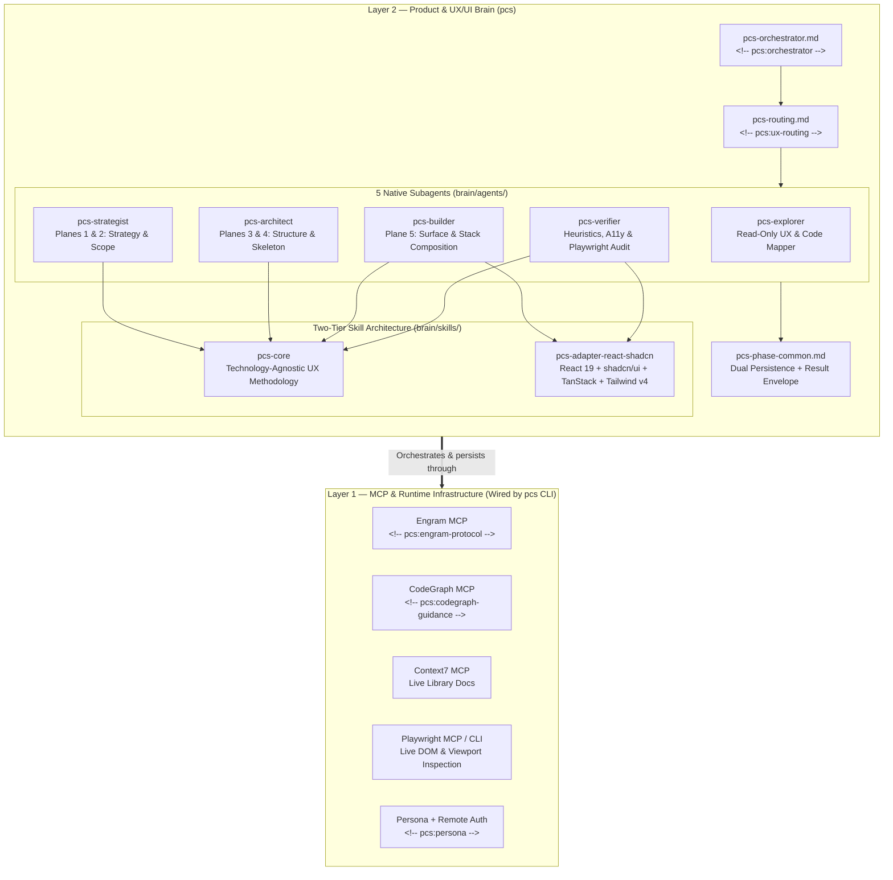

# Product Composition System (`pcs`) — Architecture Specification

**Decision Summary:** `pcs` is a **100% standalone, self-contained Product, UX/UI & Frontend Engineering Orchestrator and Go CLI**. It owns both the **Product-Centered Development (PCD)** brain (orchestrator, 6 native UX/UI subagents, the technology-agnostic `pcs-core` methodology skill, and pluggable frontend stack adapters such as `pcs-adapter-react-shadcn`) and the direct runtime wiring for persistent memory (`Engram`), structural code intelligence (`CodeGraph`), live documentation retrieval (`Context7`), persona, and runtime security boundaries.

---

## 1. Two-Layer System Architecture

`pcs` organizes its capabilities into **Foundational MCP & Runtime Infrastructure (Layer 1)** and **Product & UX/UI Composition Intelligence (Layer 2)**, managed end-to-end by the `pcs` CLI.



### Subsystem Responsibility Matrix

| Subsystem | Owner | Mechanism | Purpose in `pcs` |
|-----------|-------|-----------|------------------|
| Persistent Memory | `pcs` (Layer 1) | `mcp__engram__*` (`mem_save`, `mem_search`, `mem_get_observation`, `mem_context`), `<!-- pcs:engram-protocol -->` | Persists `pcs/<feature>/*` observations across sessions and compactions |
| Structural Code Intelligence | `pcs` (Layer 1) | `mcp__codegraph__codegraph_explore`, `pcs codegraph init`, `<!-- pcs:codegraph-guidance -->` | Safely initializes `.codegraph/` and maps routes, components, hooks, and blast radius before filesystem scans |
| Live Library Documentation | `pcs` (Layer 1) | `mcp__context7__*` | Verifies up-to-date API signatures for UI primitives, routers, and form libraries |
| Voice, Language & Safety | `pcs` (Layer 1) | `<!-- pcs:persona -->`, `<!-- pcs:agent-language-contract -->`, `<!-- pcs:remote-authorization -->` | Separates conversational tone from the strict English Artifact Language Contract |
| UX Orchestration & Routing | `pcs` (Layer 2) | `<!-- pcs:orchestrator -->`, `<!-- pcs:ux-routing -->` | Routes every UI request through Product-Centered Development (PCD) |
| 5-Plane Product Execution | `pcs` (Layer 2) | `pcs-explorer`, `pcs-strategist`, `pcs-architect`, `pcs-builder`, `pcs-verifier`, `pcs-auditor` | Executes discovery, strategy/scope, structure/skeleton, surface build, post-build verification, and read-only baseline audits of existing UI |
| Agnostic UX Rules | `pcs` (Layer 2) | `brain/skills/pcs-core/` | Encodes the 5 Planes of UX, OOUX ORCA, HTA/KLM, Cognitive Laws, and 10 Heuristics |
| Stack-Specific Composition | `pcs` (Layer 2) | `brain/skills/pcs-adapter-react-shadcn/` | Maps Skeleton decisions to React 19, vanilla `shadcn/ui`, TanStack, RHF/Zod, and Tailwind v4 |

---

## 2. Product-Centered Development (PCD) Lifecycle

Every frontend or product request flows through the **PCD Protocol**. No `.tsx` component is authored for a feature until Planes 1 through 4 are explicitly crystallized and tracked.


---

## 3. Dual Artifact Persistence Contract

To guarantee both **human-reviewable Git traceability** and **cross-session AI memory recovery**, `pcs` uses a dual-persistence contract across local workspace files and Engram topic keys:

| Phase / Producer | Workspace File Artifact | Engram `topic_key` (`type: "architecture"`) | Contents |
|------------------|-------------------------|---------------------------------------------|----------|
| `pcs-explorer` | *(Optional inline / spec section)* | `pcs/{feature-name}/explore` | Route map, reusable `src/components/*` inventory, domain entities, current UX bottlenecks |
| `pcs-strategist` | `pcs/specs/{feature-name}.md` (Planes 1–2) | `pcs/{feature-name}/strategy` | Role profile, JTBD, Declared Assumptions, OOUX ORCA matrix, HTA/KLM click budget, MVP slice |
| `pcs-architect` | `pcs/specs/{feature-name}.md` (Planes 3–4) | `pcs/{feature-name}/architecture` | IA tree, State-Complete flow (Happy + 5 Negative Paths), Container Decision Matrix, Friction Matrix, ASCII wireframe |
| `pcs-architect` | `pcs/tasks/{feature-name}.md` | `pcs/{feature-name}/tasks` | Ordered implementation work units, allowed edit surfaces per unit, verification gates |
| `pcs-builder` | `pcs/tasks/{feature-name}.md` (updated checkboxes) | `pcs/{feature-name}/apply` | Implemented component paths, state coverage proof, work-unit progress |
| `pcs-verifier` | `pcs/specs/{feature-name}.md` (Verification section) | `pcs/{feature-name}/verify` | 10 Heuristic scores (0–4), 4-Question Cognitive Walkthrough, A11y & Playwright findings |
| `pcs-auditor` (persisted by the Coordinator) | `pcs/audits/{feature-name}.md` | `pcs/{feature-name}/audit` | Baseline Audit Report of existing UI: 10 Heuristic scores (0–4), 5 Negative States checklist, Cognitive Walkthrough, WCAG/keyboard findings, ordered fixes, Severity 3–4 verdict |

All automated `mem_save` calls inside `pcs` phases set `capture_prompt: false` (when supported by the active Engram schema) so pipeline artifacts do not pollute human prompt capture.

---

## 4. Core vs. Stack Adapter Separation

`pcs` prevents methodology lock-in by splitting UX knowledge into two composable layers:

1. **`pcs-core` (Technology-Agnostic UX Core)**:
   - Operates purely on human-computer interaction, cognitive psychology, information architecture, and product strategy.
   - Contains **zero framework-specific APIs** and **zero external product company names**.
   - Defines *why* a container must be a contextual side panel vs. a modal dialog, *how* to separate Zero-Data from No-Results states, and *how* to score interfaces against the 10 Usability Heuristics.
2. **`pcs-adapter-*` (Pluggable Stack Adapters)**:
   - Translates Plane 4 Skeleton decisions and Plane 5 Surface rules into concrete framework primitives.
   - Default implementation: `pcs-adapter-react-shadcn` (React 19, TypeScript, Tailwind CSS v4, vanilla `shadcn/ui`, `radix-ui` escape hatch, `@tanstack/react-router`, `@tanstack/react-query`, `@tanstack/react-table`, `react-hook-form` + `zod`).
   - Future stack adapters (e.g., Vue/Nuxt, SvelteKit, Next.js App Router, or mobile stacks) can be swapped in without modifying `pcs-core`, `pcs-orchestrator`, `pcs-strategist`, or `pcs-architect`.

---

## 5. Deployment, CLI Lifecycle & Scope Resolution

`pcs` ships as a standalone, zero-dependency Go CLI (`cmd/pcs`) supporting three scopes (`--scope global|workspace|profile`, defaulting to `global`, and respecting `PCS_INSTALL_SCOPE` and `CLAUDE_CONFIG_DIR`). It embeds `brain/**` and `docs/skill-style-guide.md` directly into the binary via `//go:embed` (`embed.go`) and automatically wires `engram`, `context7`, and `codegraph` MCP servers.

### Scope Resolution Order

1. Explicit `--scope <global|workspace|profile>` flag (or `--profile` alias).
2. `PCS_INSTALL_SCOPE` environment variable fallback.
3. Default scope: **`global`**.
   - When `scope == "global"` and `--target-dir` is omitted: if `CLAUDE_CONFIG_DIR` is set in the environment, `pcs` targets `$CLAUDE_CONFIG_DIR` (writing MCP servers to `$CLAUDE_CONFIG_DIR/.claude.json`); otherwise it targets `$HOME/.claude` (writing MCP servers to `$HOME/.claude.json`).
   - When `scope == "profile"` and `--target-dir` is omitted: `pcs` uses `--profile-dir` and defaults to `$HOME/.claude-pcs`. Profile scope ignores `$CLAUDE_CONFIG_DIR` and refuses any profile target that resolves (after `Abs`/`Clean`/symlink resolution, case-insensitively on Windows) to `$HOME`, to `$HOME/.claude` or `$CLAUDE_CONFIG_DIR` or any of their ancestors, or whose derived `.claude.json`/`settings.json` is the main profile's file. The `$CLAUDE_CONFIG_DIR` checks are skipped when that directory already holds a pcs profile install (as inside a `claude-pcs` session); `$HOME/.claude` is never exempt.
   - `pcs sync` never creates a new install: it refuses when the resolved target has no `.pcs-state.json`. Without an explicit selector (`--scope`, `--profile`, `--profile-dir`, `--target-dir`, or `PCS_INSTALL_SCOPE`), it discovers installs in the global target and the default profile, syncs the only one found, and requires `--scope` when several exist.
   - `pcs uninstall` without an explicit selector discovers installs the same way and refuses when none or several exist; `--force` additionally requires `--scope`, `--profile`, `--profile-dir`, or `--target-dir` on the command line (`PCS_INSTALL_SCOPE` does not count). `pcs install` without an explicit selector refuses when a profile install exists and no global install does.

### Granular Prompt Guidance, MCP Config, and Hook Wiring

`pcs install` and `pcs sync` separate prompt guidance from JSON config mutation:
- `--mcp-guidance=true` (default `true`): Injects `<!-- pcs:codegraph-guidance -->` and `<!-- pcs:engram-protocol -->` into `CLAUDE.md` alongside `<!-- pcs:persona -->`, `<!-- pcs:orchestrator -->`, and `<!-- pcs:ux-routing -->`. Setting `--mcp-guidance=false` omits or actively removes those two MCP prompt blocks.
- `--write-mcp-config` (default `false`): Atomically merges only missing MCP servers (`engram`, `context7`, `codegraph`) into `.claude.json` (never overwriting pre-existing server definitions) and adds missing MCP permissions/plugins into `settings.json` with one-time `.pre-pcs.bak` backups and delta tracking in `.pcs-state.json`.
- `--write-hook` (default `false`): Adds the `UserPromptSubmit` hook (`pcs skill-registry refresh`) into `settings.json`.
- `--with-hooks` / `--no-hooks` (default: on for `--scope profile`, off otherwise; remembered by `pcs sync`): Writes the PCD flow hooks into `settings.json`. Each command is the absolute path of the running `pcs` binary in Git Bash form (for example `"%LOCALAPPDATA%/pcs/bin/pcs.exe" hook stop` rendered as an absolute forward-slash path, or `"/usr/local/bin/pcs" hook stop`); pcs warns when that binary lives in a temporary directory. The merge replaces only pcs flow hook commands (identified by `pcs hook <event>` or the binary recorded in `.pcs-state.json` as `flow_hook_binary`), preserves every other hook, and `pcs uninstall` removes exactly those entries. `pcs doctor --scope profile` reports the `flow-hooks` check.

| Hook event | Matcher | Command | Effect |
|------------|---------|---------|--------|
| `PreToolUse` | `Read\|Grep\|Glob\|Bash\|Edit\|Write\|MultiEdit\|NotebookEdit\|Agent\|Task` | `pcs hook pre-tool-use` | Subagent calls (non-empty `agent_id`) pass. Main-thread reads of project source and non-allowlisted `Bash` are denied without an active flow, counted against the 3-read budget of an `inline` flow, and denied with the next delegation in `audit`/`t2`/`t3` flows. Edits are allowed only for the single file of an `inline` flow (and under `pcs/` or `.atl/`); `.pcs/` is CLI-owned. `pcs-*` delegations are denied without a flow or before their prerequisite phases are done. Main-thread `Agent`/`Task` calls with any other `subagent_type` (including `Explore`, `general-purpose`, `fork`, or none) are denied with "Use the pcs-* agent returned by pcs flow next", except `claude-code-guide` and `statusline-setup`. Main-thread `Bash` that runs `pcs flow record` (any path or wrapper) is denied, because phase completion comes only from the `SubagentStop` hook; a human can still run it in their own terminal |
| `SubagentStop` | — | `pcs hook subagent-stop` | Maps a `pcs-*` agent to its phase. It parses the last `Status:` line, with optional markdown emphasis or bullets, from `last_assistant_message` and falls back to the transcript. It records `done` (`success`/`partial`/`done`; `verify` only on `success`, where `partial` is `blocked` with a note), `blocked`, or `unverified` (no status line). A `done` phase is never downgraded, and every run is appended to the phase `runs` |
| `Stop` | — | `pcs hook stop` | Blocks the turn while the active flow has pending phases, and once more to require `pcs flow close`; never blocks when `stop_hook_active` is true, the flow belongs to another session, or the flow is `awaiting_user` (`pcs flow await`); the block reason names that escape |
| `UserPromptSubmit` | — | `pcs hook user-prompt-submit` | Injects the start rule (no flow) or the active flow's status and next step; adds the adopt/abandon notice when the active flow belongs to another session; clears the session's `awaiting_user` mark and says the user answered the blocking question |

Session binding: every hook event claims an unowned active flow for its stdin `session_id` (`owner_session_id`, `claimed_at`), so the session that ran `pcs flow start` owns the flow from its next event. A flow owned by another session is foreign: `PreToolUse` gates as if no flow were active, with a reason naming `pcs flow adopt` (clears the owner so the next event of the running session claims it) and `pcs flow close --abandon`; `SubagentStop` records nothing into it. `pcs flow start` auto-abandons an active flow whose `updated_at` (refreshed on every state write; `created_at` for older state files) is more than 12 hours old.

Interactive blocking question: before asking the user its one blocking question, the Coordinator runs `pcs flow await --question "..."`. It sets `awaiting_user` (question, `asked_at`) on the active flow owned by the session in `$CLAUDE_CODE_SESSION_ID` (or `--session`), refuses a foreign flow, and requires a question. `Stop` then lets the turn end, and the owning session's next `UserPromptSubmit` clears the mark, so `Stop` blocks again until the flow advances. Non-interactive runs record a Declared Assumption instead.

Flow kinds and their mandatory ordered phases (`pcs flow start --kind ...`): `audit` = `explore` (`pcs-explorer`) -> `audit` (`pcs-auditor` or `pcs-verifier`); `inline` = no delegated phases, main-thread budget of 3 counted reads and 1 edited file; `t2` and `t3` = `explore` -> `strategy` (`pcs-strategist`) -> `architecture` (`pcs-architect`) -> `apply` (`pcs-builder`) -> `verify` (`pcs-verifier`).

The injected routing makes `pcs flow start` the first action of any request that needs project files and has the Coordinator execute each `pcs flow next --json` transition verbatim; it carries no call-count threshold for inline work. An `audit` flow (read-only review of existing UI) never runs inline: `pcs-explorer` maps the feature, `pcs-auditor` returns a baseline Audit Report without needing a spec, and the Coordinator writes it to `pcs/audits/<feature>.md`, saves Engram `pcs/<feature>/audit`, and runs `pcs flow close`. App login credentials travel only inside the delegated prompt.

| MCP Server | Configured Command | `settings.json` Permissions & Plugins |
|------------|--------------------|---------------------------------------|
| **`engram`** | Resolved `engram` binary on `$PATH` (falling back to `/opt/homebrew/bin/engram`) with `mcp --tools=agent` | `mcp__engram__*`, `mcp__plugin_engram_engram__*`, `enabledPlugins["engram@engram"] = true` |
| **`context7`** | `npx -y --package=@upstash/context7-mcp@2.2.5 -- context7-mcp` | `mcp__context7__*` |
| **`codegraph`** | `codegraph serve --mcp` (`stdio`) | `mcp__codegraph__*` |

### Mode A: Global Scope (`--scope global`, Default)

```bash
# Safe default: installs CLAUDE.md markers, agents, and skills into ~/.claude without touching .claude.json or settings.json
pcs install --adapter react-shadcn --persona gentleman

# Opt-in MCP and hook configuration
pcs install --write-mcp-config --write-hook

# Or targets an isolated Claude config directory via CLAUDE_CONFIG_DIR
CLAUDE_CONFIG_DIR="$HOME/.claude-pcs" pcs install
```

1. Preserves all existing user settings, custom agents, skills, and projects in `~/.claude` and `~/.claude.json`.
2. Upserts `pcs:*` markers into `CLAUDE.md` while preserving all user text and line endings outside `pcs:*` blocks byte-for-byte.
3. Installs `pcs-*.md` agents and `pcs-*` skills, tracking ownership in `.pcs-native-agent-ownership.json` and exact deltas in `.pcs-state.json` so `pcs uninstall` restores pre-install state cleanly.

### Mode B: Workspace Scope (`--scope workspace`, `<repo>/.claude`)

```bash
pcs install --scope workspace --target-dir /path/to/frontend-repo/.claude
```

1. Writes `pcs-*.md` agents into `<repo>/.claude/agents/` and `pcs-*` skills into `<repo>/.claude/skills/`.
2. Upserts `pcs:*` markers into `<repo>/CLAUDE.md`.
3. Runs `pcs skill-registry refresh` to generate `<repo>/.atl/pcs-skill-registry.md` with a deterministic SHA-256 content hash header (removed automatically on `pcs uninstall`).

### Mode C: Explicit Profile Scope (`--scope profile`, `~/.claude-pcs`)

```bash
pcs install --scope profile --profile-dir ~/.claude-pcs --adapter react-shadcn --persona gentleman
```

1. Creates `~/.claude-pcs` (or `--profile-dir`) with `CLAUDE.md`, `agents/pcs-*.md`, `skills/{_shared,pcs-core,pcs-adapter-react-shadcn}`, and optional `.claude.json` / `settings.json`.
2. Generates cross-platform, process-scoped launchers in `<profile-dir>/bin/` and automatically installs them into the user's bin directory on `PATH` (`~/.local/bin` on Unix/macOS, `%LOCALAPPDATA%\pcs\bin` on Windows, or `--launcher-dir <dir>`):
   - `claude-pcs` (POSIX shell script using `exec env CLAUDE_CONFIG_DIR='...' 'claude' <launcher-args> "$@" --mcp-config '...'`, every value single-quoted)
   - `claude-pcs.cmd` (Windows Command Prompt batch script using `setlocal DisableDelayedExpansion` / `endlocal` to prevent environment variable leakage, every value double-quoted with `%` doubled)
   - `claude-pcs.ps1` (Windows PowerShell script using `try { ... } finally { $env:CLAUDE_CONFIG_DIR = $prev }`, every value single-quoted)

   User arguments always precede `--mcp-config <profile-dir>/shared-mcp.json`, which comes last with a single value because Claude Code parses `--mcp-config` as a variadic option. `--launcher-args` is split into individual arguments (unquoted whitespace separates words; single or double quotes group words; backslashes and shell metacharacters such as `$`, backtick, `%`, and `^` are literal; an unterminated quote is an error) and each argument is quoted for each launcher syntax, so it reaches `claude` exactly as written.
3. Reuses main profile MCP servers without touching `~/.claude.json`: reads `~/.claude.json` and writes `<profile-dir>/shared-mcp.json` with restricted permissions (0600), passing `--mcp-config <profile-dir>/shared-mcp.json` directly in the launcher. When the main profile defines no `engram` server, `pcs` adds one pointing at the resolved `engram` binary (on install and sync); without a resolvable binary it writes no entry and warns. When it defines no `playwright` server, `pcs` adds `npx -y @playwright/mcp@0.0.83 --output-dir .pcs/playwright` (version pinned in `mcp.PlaywrightMCPPackage`) for the `pcs-auditor` visual pass, so its artifacts stay under the git-ignored `.pcs/`. Both additions are recorded in `shared_mcp_added_servers` and are not drift. `pcs doctor --scope profile` fails when the profile has no Engram source (neither that server nor `enabledPlugins["engram@engram"]` in the profile `settings.json`).
4. Inherits custom `statusLine` from `~/.claude/settings.json` automatically (unless `--no-statusline` is specified) and, with `--with-plugins`, runs `claude plugin marketplace add Gentleman-Programming/engram` followed by `claude plugin install engram@engram` under the profile `CLAUDE_CONFIG_DIR`, reporting each failure with the exact per-OS manual command. Every printed hint scopes `CLAUDE_CONFIG_DIR` to the command it runs (a POSIX per-command prefix, a PowerShell block that restores the previous value in `finally`, or a `cmd /s /c` child process), and the launch hint is `claude-pcs` itself (its absolute path when the launcher directory is not on `PATH`). `--no-statusline` and `--with-plugins` are persisted in `.pcs-state.json` (`schema_version` 1) and honored by `pcs sync` unless overridden. For a legacy state (no `schema_version`), `pcs sync` treats a missing `no_statusline` as unknown unless `added_status_line` proves a copy: it keeps the profile's current statusLine state and records the result. It also migrates missing `added_mcp_servers`/`added_permissions`/`added_plugins` lists to explicit empty records only when no default server, permission, or `engram@engram` entry is present in the target file; otherwise the list stays unrecorded, because the entry may predate `pcs`. `pcs` records the files (`created_claude_md`, `created_claude_json`, `created_settings_json`) and settings containers (`created_settings_keys`) it created, never writes a `.pre-pcs.bak` for them, and on uninstall deletes them once empty. In profile scope, `pcs doctor` checks MCP servers in `shared-mcp.json` (and the profile `.claude.json`).
5. Guides the user to run `claude-pcs` followed by `/login` for first-run profile authentication. `pcs doctor --scope profile` validates launcher presence on `PATH`, `shared-mcp.json` presence and drift against the main profile `mcpServers`, `enabledPlugins["engram@engram"]` when plugins were requested, and `.credentials.json` presence without reading secret content (on macOS a missing file is reported as unknown because credentials live in the Keychain).
