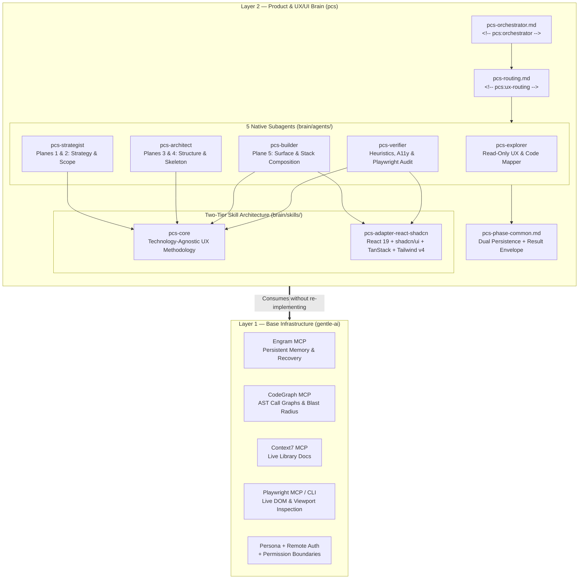
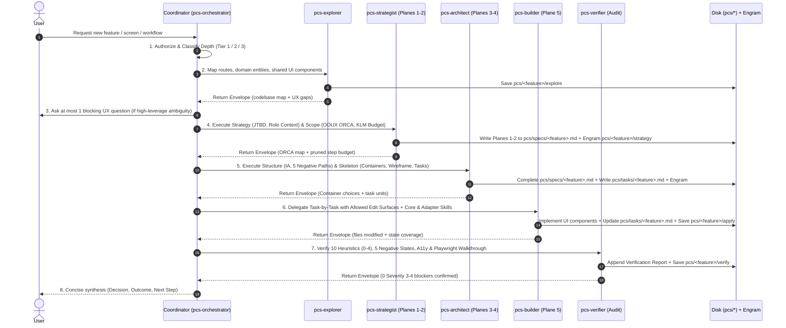

# Product Composition System (`pcs`) — Architecture Specification

**Decision Summary:** `pcs` is a specialized **Product & UX/UI Brain** that layers cleanly on top of `gentle-ai` without duplicating its base infrastructure. `gentle-ai` owns persistent memory (`Engram`), structural code intelligence (`CodeGraph`), live documentation retrieval (`Context7`), persona, and runtime security; `pcs` owns the **Product-Centered Development (PCD)** orchestrator, 5 native UX/UI subagents, the technology-agnostic `pcs-core` methodology skill, and pluggable frontend stack adapters (`pcs-adapter-react-shadcn`).

---

## 1. Two-Layer System Architecture

`pcs` enforces a strict separation of concerns between **Base AI Infrastructure (Layer 1)** and **Product & UX/UI Composition Intelligence (Layer 2)**.



### Layer Responsibility Matrix

| Subsystem | Owner | Mechanism | Purpose in `pcs` |
|-----------|-------|-----------|------------------|
| Persistent Memory | `gentle-ai` (Layer 1) | `mcp__engram__*` (`mem_save`, `mem_search`, `mem_get_observation`, `mem_context`) | Persists `pcs/<feature>/*` observations across sessions and compactions |
| Structural Code Intelligence | `gentle-ai` (Layer 1) | `mcp__codegraph__codegraph_explore` | Maps routes, components, hooks, and blast radius before filesystem scans |
| Live Library Documentation | `gentle-ai` (Layer 1) | `mcp__context7__*` | Verifies up-to-date API signatures for UI primitives, routers, and form libraries |
| Voice, Language & Safety | `gentle-ai` (Layer 1) | `<!-- gentle-ai:persona -->`, `<!-- gentle-ai:remote-authorization -->` | Separates conversational tone from the strict English Artifact Language Contract |
| UX Orchestration & Routing | `pcs` (Layer 2) | `<!-- pcs:orchestrator -->`, `<!-- pcs:ux-routing -->` | Routes every UI request through Product-Centered Development (PCD) |
| 5-Plane Product Execution | `pcs` (Layer 2) | `pcs-explorer`, `pcs-strategist`, `pcs-architect`, `pcs-builder`, `pcs-verifier` | Executes discovery, strategy/scope, structure/skeleton, surface build, and heuristic audit |
| Agnostic UX Rules | `pcs` (Layer 2) | `brain/skills/pcs-core/` | Encodes the 5 Planes of UX, OOUX ORCA, HTA/KLM, Cognitive Laws, and 10 Heuristics |
| Stack-Specific Composition | `pcs` (Layer 2) | `brain/skills/pcs-adapter-react-shadcn/` | Maps Skeleton decisions to React 19, vanilla `shadcn/ui`, TanStack, RHF/Zod, and Tailwind v4 |

---

## 2. Product-Centered Development (PCD) Lifecycle

Every frontend or product request flows through the **PCD Protocol**. No `.tsx` component is authored for a feature until Planes 1 through 4 are explicitly crystallized and tracked.



---

## 3. Dual Artifact Persistence Contract

To guarantee both **human-reviewable Git traceability** and **cross-session AI memory recovery**, `pcs` uses a dual-persistence contract across local workspace files and Engram topic keys:

| Phase / Producer | Workspace File Artifact | Engram `topic_key` (`type: "architecture"`) | Contents |
|------------------|-------------------------|---------------------------------------------|----------|
| `pcs-explorer` | *(Optional inline / spec section)* | `pcs/{feature-name}/explore` | Route map, reusable `src/components/*` inventory, domain entities, current UX bottlenecks |
| `pcs-strategist` | `pcs/specs/{feature-name}.md` (Planes 1–2) | `pcs/{feature-name}/strategy` | Role profile, JTBD, Declared Assumptions, OOUX ORCA matrix, HTA/KLM click budget, MVP slice |
| `pcs-architect` | `pcs/specs/{feature-name}.md` (Planes 3–4) | `pcs/{feature-name}/architecture` | IA tree, State-Complete flow (Happy + 5 Negative Paths), Container Decision Matrix, Friction Matrix, ASCII wireframe |
| `pcs-architect` | `pcs/tasks/{feature-name}.md` | `pcs/{feature-name}/tasks` | Ordered implementation work units, allowed edit surfaces per unit, verification gates |
| `pcs-builder` | `pcs/tasks/{feature-name}.md` (updated checkboxes) | `pcs/{feature-name}/apply` | Implemented component paths, state coverage proof, work-unit progress |
| `pcs-verifier` | `pcs/specs/{feature-name}.md` (Verification section) | `pcs/{feature-name}/verify` | 10 Heuristic scores (0–4), 4-Question Cognitive Walkthrough, A11y & Playwright findings |

All automated `mem_save` calls inside `pcs` phases set `capture_prompt: false` (when supported by the active Engram schema) so pipeline artifacts do not pollute human prompt capture.

---

## 4. Core vs. Stack Adapter Separation

`pcs` prevents methodology lock-in by splitting UX knowledge into two composable layers:

1. **`pcs-core` (Technology-Agnostic UX Core)**:
   - Operates purely on human-computer interaction, cognitive psychology, information architecture, and product strategy.
   - Contains **zero framework-specific APIs** and **zero external product company names**.
   - Defines *why* a container must be a contextual side panel vs. a modal dialog, *how* to separate Zero-Data from No-Results states, and *how* to score interfaces against the 10 Usability Heuristics.
2. **`pcs-adapter-*` (Pluggable Stack Adapters)**:
   - Translates Plane 4 Skeleton decisions and Plane 5 Surface rules into concrete framework primitives.
   - Default implementation: `pcs-adapter-react-shadcn` (React 19, TypeScript, Tailwind CSS v4, vanilla `shadcn/ui`, `radix-ui` escape hatch, `@tanstack/react-router`, `@tanstack/react-query`, `@tanstack/react-table`, `react-hook-form` + `zod`).
   - Future stack adapters (e.g., Vue/Nuxt, SvelteKit, Next.js App Router, or mobile stacks) can be swapped in without modifying `pcs-core`, `pcs-orchestrator`, `pcs-strategist`, or `pcs-architect`.

---

## 5. Deployment, CLI Lifecycle & Scope Resolution (`gentle-ai` Parity)

`pcs` ships as a standalone, zero-dependency Go CLI (`cmd/pcs`) that mirrors `gentle-ai`'s exact scope ergonomics (`--scope global|workspace`, defaulting to `global`, respecting `PCS_INSTALL_SCOPE` and `CLAUDE_CONFIG_DIR`, plus an optional `profile` shorthand). It embeds `brain/**` and `docs/skill-style-guide.md` directly into the binary via `//go:embed` (`embed.go`) and automatically wires `engram`, `context7`, and `codegraph` MCP servers.

### Scope Resolution Order

1. Explicit `--scope <global|workspace|profile>` flag (or `--profile` alias).
2. `PCS_INSTALL_SCOPE` environment variable fallback (matching `gentle-ai`'s `GENTLE_AI_INSTALL_SCOPE`).
3. Default scope: **`global`**.
   - When `scope == "global"` and `--target-dir` is omitted: if `CLAUDE_CONFIG_DIR` is set in the environment, `pcs` targets `$CLAUDE_CONFIG_DIR` (writing MCP servers to `$CLAUDE_CONFIG_DIR/.claude.json`); otherwise it targets `$HOME/.claude` (writing MCP servers to `$HOME/.claude.json`).

### Automated MCP Infrastructure Wiring (`--with-mcp=true`)

When `pcs install` runs with `--with-mcp=true` (the default), `internal/mcp` atomically merges three foundational MCP servers into `.claude.json` (or `.mcp.json` in workspace mode) and configures `settings.json` with `.bak` backups and zero data loss on existing user keys:

| MCP Server | Configured Command | `settings.json` Permissions & Plugins |
|------------|--------------------|---------------------------------------|
| **`engram`** | `/opt/homebrew/bin/engram mcp --tools=agent` (or resolved `engram` binary on `$PATH`) | `mcp__engram__*`, `mcp__plugin_engram_engram__*`, `enabledPlugins["engram@engram"] = true` |
| **`context7`** | `npx -y --package=@upstash/context7-mcp@2.2.5 -- context7-mcp` | `mcp__context7__*` |
| **`codegraph`** | `codegraph serve --mcp` (`stdio`) | `mcp__codegraph__*` |

In addition, `settings.json` receives a `UserPromptSubmit` hook (`pcs skill-registry refresh`) if a skill-registry hook is not already registered.

### Mode A: Global Scope (`--scope global`, Default) — Coexisting with `gentle-ai` or Custom `$CLAUDE_CONFIG_DIR`

```bash
# Layers into ~/.claude + ~/.claude.json alongside gentle-ai
pcs install --adapter react-shadcn --persona gentleman

# Or targets an isolated Claude config directory via CLAUDE_CONFIG_DIR
CLAUDE_CONFIG_DIR="$HOME/.claude-pcs" pcs install
```

1. Preserves all existing `gentle-ai` blocks, agents (`sdd-*`), skills, and user projects in `~/.claude` and `~/.claude.json`.
2. Upserts `<!-- pcs:orchestrator -->` and `<!-- pcs:ux-routing -->` into `CLAUDE.md` (plus base `codegraph-guidance`, `persona`, and `engram-protocol` blocks if not yet present).
3. Installs `pcs-*.md` agents and `pcs-*` skills alongside existing `gentle-ai` assets, tracking ownership in `.pcs-native-agent-ownership.json` and `.pcs-state.json` so `pcs uninstall` removes only `pcs`-owned artifacts.

### Mode B: Workspace Scope (`--scope workspace`, `<repo>/.claude`)

```bash
pcs install --scope workspace --target-dir /path/to/frontend-repo/.claude
```

1. Writes `pcs-*.md` agents into `<repo>/.claude/agents/` and `pcs-*` skills into `<repo>/.claude/skills/`.
2. Upserts `<!-- pcs:orchestrator -->` and `<!-- pcs:ux-routing -->` into `<repo>/CLAUDE.md`.
3. Runs `pcs skill-registry refresh` to generate `<repo>/.atl/skill-registry.md` with a deterministic SHA-256 content hash header.

### Mode C: Explicit Profile Scope (`--scope profile`, `~/.claude-pcs`)

```bash
pcs install --scope profile --adapter react-shadcn --persona gentleman --with-mcp=true
```

1. Creates `~/.claude-pcs` with `CLAUDE.md`, `agents/pcs-*.md`, `skills/{_shared,pcs-core,pcs-adapter-react-shadcn}`, `.claude.json`, `settings.json`, and an executable wrapper at `~/.claude-pcs/bin/claude-pcs`.

